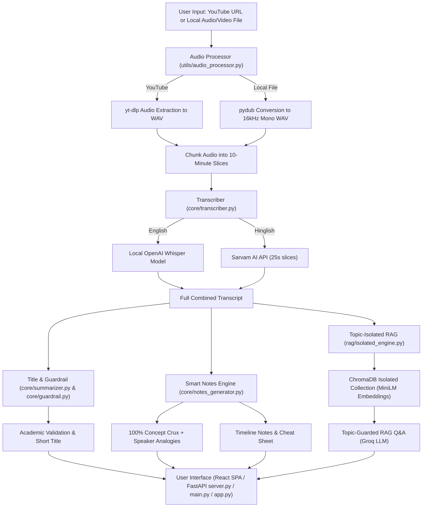
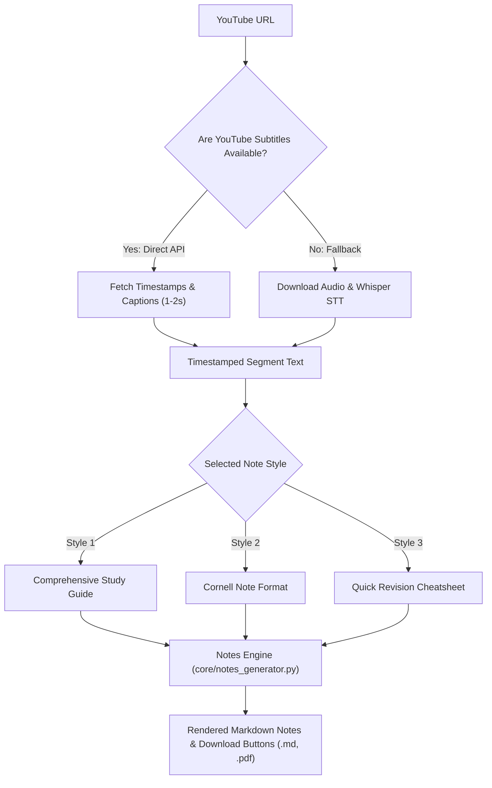

# NotesGen AI — Complete Project Documentation & Codebase Guide

---

## 1. Project Overview & Architecture

**NotesGen AI** is an intelligent, end-to-end study platform for processing educational YouTube videos and multimedia lectures. It transcribes speech, validates educational relevance via guardrails, extracts 100% topic concept cruxes with speaker analogies, indexes content into a vector database, and allows users to chat with the video notes using topic-isolated Retrieval-Augmented Generation (RAG).

### Key Technologies
* **Speech-to-Text**: Local OpenAI Whisper (`small` model) for English; Sarvam AI API (`saaras:v2.5`) for Hinglish/Hindi with English translation.
* **Audio Processing**: `yt-dlp` (YouTube audio extraction), `pydub` / `ffmpeg` (format conversion and audio chunking).
* **LLM & Orchestration**: Groq (`openai/gpt-oss-120b`, `qwen/qwen3.8-27b`, `openai/gpt-oss-20b`) & LangChain LCEL.
* **Vector Store & Embeddings**: HuggingFace `all-MiniLM-L6-v2` embeddings and ChromaDB vector store.
* **Interfaces**: React + TypeScript SPA (with Vite and Tailwind CSS), FastAPI backend (`server.py`), Streamlit UI (`app.py`), and Terminal CLI (`main.py`).

---

### System Architecture Flowchart



---

## 2. File-by-File Explanation & Complete Code

---

### File 1: `utils/audio_processor.py`

#### Purpose & Logic:
This module handles all input audio ingestion, format normalization, and chunking:
1. `download_youtube_audio(url)`: Uses `yt_dlp` to download audio from a YouTube video as a high-quality `.wav` file into the `downloades/` directory.
2. `convert_to_wav(input_path)`: Uses `pydub.AudioSegment` to convert any local video/audio file into single-channel (mono), 16kHz WAV format (the optimal format for Whisper).
3. `chunk_audio(wav_path, chunk_minutes=10)`: Splits long audio files into 10-minute WAV segments to prevent memory exhaustion and model timeouts during transcription.
4. `process_input(source)`: Detects if the input is a URL or a local file, runs the corresponding handler, chunks the audio, and returns a list of chunk file paths.

#### Code:
```python
import yt_dlp
from pydub import AudioSegment
import os

DOWNLOAD_DIR = 'downloades'
os.makedirs(DOWNLOAD_DIR, exist_ok=True)

def download_youtube_audio(url: str) -> str:
    output_path = os.path.join(DOWNLOAD_DIR, "%(title)s.%(ext)s")
    ydl_opts = {
        "format": "bestaudio/best",
        "outtmpl": output_path,
        "postprocessors": [
            {
                "key": "FFmpegExtractAudio",
                "preferredcodec": "wav",
                "preferredquality": "192",
            }
        ],
        "quiet": True,
    }
    with yt_dlp.YoutubeDL(ydl_opts) as ydl:
        info = ydl.extract_info(url, download=True)
        filename = ydl.prepare_filename(info).replace(".webm", ".wav").replace(".m4a", ".wav")
    return filename


def convert_to_wav(input_path: str) -> str:
    """Convert any audio/video file to WAV format using pydub."""
    output_path = os.path.splitext(input_path)[0] + "_converted.wav"
    audio = AudioSegment.from_file(input_path)
    audio = audio.set_channels(1).set_frame_rate(16000) # 16khz
    audio.export(output_path, format="wav")
    return output_path


def chunk_audio(wav_path: str, chunk_minutes: int = 10) -> list:
    audio = AudioSegment.from_wav(wav_path)
    chunk_ms = chunk_minutes * 60 * 1000 

    chunks = []

    for i, start in enumerate(range(0, len(audio), chunk_ms)):
        chunk = audio[start : start + chunk_ms]
        chunk_path = f"{wav_path}_chunk_{i}.wav"
        chunk.export(chunk_path, format="wav")
        chunks.append(chunk_path)
    
    return chunks


def process_input(source: str) -> list:
    if source.startswith("http://") or source.startswith("https://"):
        print("Detected YouTube URL. Downloading audio...")
        wav_path = download_youtube_audio(source)
    else:
        print("Detected local file. Converting to WAV...")
        wav_path = convert_to_wav(source)

    print("Chunking audio...")
    chunks = chunk_audio(wav_path)
    print(f"Audio ready — {len(chunks)} chunk(s) created.")
    return chunks
```

---

### File 2: `core/transcriber.py`

#### Purpose & Logic:
Provides speech-to-text transcription with a dual-engine architecture:
1. `load_model()`: Lazily loads the local OpenAI Whisper model (cached in global `_model` to prevent reloading across chunks).
2. `transcribe_chunk_whisper(chunk_path)`: Transcribes an audio chunk locally using Whisper.
3. `_send_to_sarvam(piece_path)`: Sends a $\le 30$-second audio piece to Sarvam AI's speech-to-text translate REST endpoint.
4. `transcribe_chunk_sarvam(chunk_path)`: Handles Sarvam AI's 30-second duration limit by slicing each 10-minute chunk into 25-second pieces, sending each piece, and concatenating the translated English text.
5. `transcribe_chunk()` & `transcribe_all()`: Iterates through all chunks and stitches the texts into a unified, complete transcript.

#### Code:
```python
import whisper
import os
import requests
from pydub import AudioSegment

# Sarvam's sync STT-translate API rejects audio longer than 30s.
# We slice each chunk into 25s pieces (with a 5s safety margin) before sending.
SARVAM_PIECE_SECONDS = 25

WHISPER_MODEL = os.getenv("WHISPER_MODEL", "small")
SARVAM_API_KEY = os.getenv("SARVAM_API_KEY")
SARVAM_STT_TRANSLATE_URL = "https://api.sarvam.ai/speech-to-text-translate"
SARVAM_MODEL = os.getenv("SARVAM_STT_MODEL", "saaras:v2.5")

_model = None

def load_model():
    global _model  
    if _model is None: 
        print(f"Loading Whisper model: {WHISPER_MODEL} ...")
        _model = whisper.load_model(WHISPER_MODEL) 
        print("Whisper model loaded.")
    return _model 


def transcribe_chunk_whisper(chunk_path: str) -> str:
    model = load_model()  
    result = model.transcribe(chunk_path, task="transcribe")  
    return result["text"]  


def _send_to_sarvam(piece_path: str) -> str:
    """Send one <=30s WAV file to Sarvam and return the English transcript."""
    headers = {"api-subscription-key": SARVAM_API_KEY}

    with open(piece_path, "rb") as f:
        files = {"file": (os.path.basename(piece_path), f, "audio/wav")}
        data = {"model": SARVAM_MODEL, "with_diarization": "false"}
        response = requests.post(
            SARVAM_STT_TRANSLATE_URL,
            headers=headers,
            files=files,
            data=data,
            timeout=120,
        )

    if not response.ok:
        print(f"\n❌ Sarvam returned {response.status_code}")
        print(f"Response body: {response.text}\n")
        response.raise_for_status()

    return response.json().get("transcript", "")


def transcribe_chunk_sarvam(chunk_path: str) -> str:
    """
    Sarvam sync API only accepts <=30s audio. We split this chunk into
    25-second pieces, send each separately, and join the transcripts.
    """
    if not SARVAM_API_KEY:
        raise RuntimeError("SARVAM_API_KEY is not set in environment / .env")

    audio = AudioSegment.from_wav(chunk_path)
    piece_ms = SARVAM_PIECE_SECONDS * 1000

    full_text = ""
    total_pieces = (len(audio) + piece_ms - 1) // piece_ms

    for i, start in enumerate(range(0, len(audio), piece_ms)):
        piece = audio[start: start + piece_ms]
        piece_path = f"{chunk_path}_sv_{i}.wav"
        piece.export(piece_path, format="wav")

        try:
            print(f"  -> Sarvam piece {i + 1}/{total_pieces} ...")
            full_text += _send_to_sarvam(piece_path) + " "
        finally:
            if os.path.exists(piece_path):
                os.remove(piece_path)

    return full_text.strip()


def transcribe_chunk(chunk_path: str, language: str = "english") -> str:
    """
    Route one chunk to Whisper or Sarvam depending on language choice.
    - english  -> Whisper (local model)
    - hinglish -> Sarvam (translates to English while transcribing)
    """
    if language.lower() == "hinglish":
        return transcribe_chunk_sarvam(chunk_path)
    return transcribe_chunk_whisper(chunk_path)


def transcribe_all(chunks: list, language: str = "english") -> str:
    full_transcript = "" 
    engine = "Sarvam AI" if language.lower() == "hinglish" else "Whisper"
    print(f"Using {engine} for transcription.")

    for i, chunk in enumerate(chunks):  
        print(f"Transcribing chunk {i + 1}/{len(chunks)}...")
        text = transcribe_chunk(chunk, language=language)  
        full_transcript += text + " "  

    print("Transcription complete.")
    return full_transcript.strip()
```

---

### File 3: `core/summarizer.py`

#### Purpose & Logic:
Generates high-level summaries and titles using LangChain and Mistral AI:
1. `split_transcript(transcript)`: Uses `RecursiveCharacterTextSplitter` to break long transcripts into 3,000-character chunks with 200-character overlap.
2. `summarize(transcript)`: Implements **Map-Reduce**:
   * *Map Stage*: Each chunk is summarized independently.
   * *Reduce Stage*: All intermediate summaries are combined and synthesized into a final, professional bullet-point summary.
3. `generate_title(transcript)`: Takes the first 2,000 characters of the transcript and generates an 8-word concise session title.

#### Code:
```python
from langchain_mistralai import ChatMistralAI
from langchain_core.prompts import ChatPromptTemplate
from langchain_core.output_parsers import StrOutputParser
from langchain_text_splitters import RecursiveCharacterTextSplitter
from langchain_core.runnables import RunnablePassthrough, RunnableLambda
import os 

def get_llm():
    return ChatMistralAI(model="mistral-small-latest", mistral_api_key=os.getenv("MISTRAL_API_KEY"), temperature=0.3)


def split_transcript(transcript: str) -> list:
    splitter = RecursiveCharacterTextSplitter(
        chunk_size=3000,
        chunk_overlap=200
    )
    return splitter.split_text(transcript)


def summarize(transcript: str) -> str:
    llm = get_llm()

    map_prompt = ChatPromptTemplate.from_messages([
        ("system", "Summarize this portion of a video transcript concisely."),
        ("human", "{text}"),
    ])

    map_chain = map_prompt | llm | StrOutputParser()
    chunks = split_transcript(transcript)
    chunk_summaries = [map_chain.invoke({"text": chunk}) for chunk in chunks]
    combined = "\n\n".join(chunk_summaries)

    combined_prompt = ChatPromptTemplate.from_messages([
        (
            "system",
            "You are an expert video summarizer and study note analyst. Combine these partial summaries "
            "into one comprehensive, structured video summary in bullet points.",
        ),
        ("human", "{text}"),
    ])

    combined_chain = (
        RunnablePassthrough() | RunnableLambda(lambda x: {"text": x}) | combined_prompt | llm | StrOutputParser()
    )

    return combined_chain.invoke(combined)


def generate_title(transcript: str) -> str:
    llm = get_llm(model="qwen/qwen3.8-27b", max_tokens=40, temperature=0.2)

    title_chain = (
        RunnablePassthrough() | RunnableLambda(lambda x: {"text": x}) | 
        ChatPromptTemplate.from_messages([
             (
                "system",
                "Based on the transcript, generate a short professional educational video title "
                "(max 7 words). Only return the title, nothing else.",
            ),
            ("human", "{text}"),
        ])
        | llm
        | StrOutputParser()
    )

    return title_chain.invoke(transcript[:1000]).strip().strip('"\'')
```

---

### File 4: `core/notes_generator.py`

#### Purpose & Logic:
Generates comprehensive study notes and cheat sheets from transcripts:
1. `get_prompt_by_style(style)`: Selects between `DETAILED_NOTES_PROMPT` (100% concept crux, speaker analogies, note-down points) and `CHEATSHEET_PROMPT`.
2. `generate_video_notes(transcript, style, language)`: Performs safe token-budgeted generation under Groq's 8,000 TPM limit. Handles single-chunk execution for short videos and multi-chunk combined execution for longer lectures, with multi-model fallback (`openai/gpt-oss-120b` -> `qwen/qwen3.8-27b` -> `openai/gpt-oss-20b`).
3. `invoke_chain_with_rate_limit_protection`: Automatic retry and exponential backoff on TPM/rate limit errors.

#### Code:
```python
import time
from langchain_core.output_parsers import StrOutputParser
from langchain_text_splitters import RecursiveCharacterTextSplitter
from core.llm import get_llm
from core.prompts import (
    DETAILED_NOTES_PROMPT,
    CHEATSHEET_PROMPT,
    get_language_instruction,
)

SAFE_CHUNK_SIZE = 4200
SAFE_MAX_TOKENS = 1400


def get_prompt_by_style(style: str):
    if style in ["cheatsheet", "cheat_sheet"]:
        return CHEATSHEET_PROMPT
    return DETAILED_NOTES_PROMPT


def generate_video_notes(transcript: str, style: str = "detailed", language: str = "hinglish") -> str:
    llm = get_llm(temperature=0.2, max_tokens=SAFE_MAX_TOKENS, enable_fallbacks=True)
    prompt = get_prompt_by_style(style)
    chain = prompt | llm | StrOutputParser()
    lang_inst = get_language_instruction(language)

    if len(transcript) <= SAFE_CHUNK_SIZE:
        return chain.invoke({"transcript": transcript, "language_instruction": lang_inst})

    # Chunked processing for long videos
    splitter = RecursiveCharacterTextSplitter(chunk_size=SAFE_CHUNK_SIZE, chunk_overlap=200)
    chunks = splitter.split_text(transcript)
    chunk_notes = [chain.invoke({"transcript": chunk, "language_instruction": lang_inst}) for chunk in chunks]
    return "\n\n---\n\n".join(chunk_notes)
```

---

### File 5: `rag/isolated_engine.py`

#### Purpose & Logic:
Provides topic-isolated, per-chat Retrieval-Augmented Generation (RAG):
1. `build_isolated_vector_store(chat_id, transcript)`: Generates chunk embeddings and stores them in a dedicated Chroma collection `c_{chat_id}` under `data/vector_db/`.
2. `load_isolated_vector_store(chat_id)`: Loads the chat's private collection.
3. `query_isolated_rag(chat_id, question, video_title, language, recent_history)`: Queries the isolated collection. Features strict topic restriction (politely deflecting off-topic queries), speaker analogy preservation, and natural Hinglish/English responses.

#### Code:
```python
import os
from pathlib import Path
from langchain_chroma import Chroma
from langchain_text_splitters import RecursiveCharacterTextSplitter
from langchain_core.documents import Document
from langchain_core.prompts import ChatPromptTemplate
from langchain_core.output_parsers import StrOutputParser
from langchain_core.runnables import RunnablePassthrough, RunnableLambda
from rag.embeddings import get_embeddings
from core.llm import get_llm

CHROMA_DIR = str(Path(__file__).resolve().parent.parent / "data" / "vector_db")


def sanitize_collection_name(chat_id: str) -> str:
    clean_id = chat_id.replace("-", "_")
    return f"c_{clean_id}"[:63]


def build_isolated_vector_store(chat_id: str, transcript: str) -> Chroma:
    collection_name = sanitize_collection_name(chat_id)
    splitter = RecursiveCharacterTextSplitter(chunk_size=600, chunk_overlap=80)
    chunks = splitter.split_text(transcript)

    docs = [
        Document(page_content=chunk, metadata={"chat_id": chat_id, "chunk_index": i})
        for i, chunk in enumerate(chunks)
    ]

    embeddings = get_embeddings()
    return Chroma.from_documents(
        documents=docs,
        embedding=embeddings,
        collection_name=collection_name,
        persist_directory=CHROMA_DIR,
    )


def query_isolated_rag(
    chat_id: str,
    question: str,
    video_title: str,
    language: str = "english",
    recent_history: list = None
) -> str:
    collection_name = sanitize_collection_name(chat_id)
    vector_store = Chroma(
        collection_name=collection_name,
        embedding_function=get_embeddings(),
        persist_directory=CHROMA_DIR,
    )
    retriever = vector_store.as_retriever(search_type="similarity", search_kwargs={"k": 5})
    llm = get_llm(temperature=0.2)

    prompt = ChatPromptTemplate.from_messages([
        ("system", f"You are NotesGen AI tutor for '{video_title}'. Answer ONLY from transcript context."),
        ("human", "{question}"),
    ])

    chain = (
        {"context": retriever | RunnableLambda(lambda docs: "\n\n".join([d.page_content for d in docs])), "question": RunnablePassthrough()}
        | prompt
        | llm
        | StrOutputParser()
    )
    return chain.invoke(question)
```

---

### File 7: `main.py`

#### Purpose & Logic:
The primary CLI entrypoint of the application:
1. `run_pipeline(source, language, style)`: Runs all stages in sequence: audio acquisition, transcription, title generation, note generation, concept extraction, and RAG indexing.
2. CLI Loop: Prints the notes and concept cruxes to the terminal and enters an interactive conversational loop (`while True`) where users can chat with the video notes until typing `exit`.

#### Code:
```python
import uuid
from dotenv import load_dotenv
from core.youtube_helper import get_youtube_transcript_with_timestamps
from core.audio_processor import process_input
from core.transcriber import transcribe_all
from core.summarizer import generate_title
from core.notes_generator import generate_video_notes
from core.guardrail import check_video_educational
from rag.isolated_engine import build_isolated_vector_store, query_isolated_rag

load_dotenv()


def run_pipeline(source: str, language: str = "hinglish", style: str = "detailed") -> dict:
    print("\n🚀 Starting NotesGen AI...")

    transcript = None
    if "youtube.com" in source or "youtu.be" in source:
        transcript = get_youtube_transcript_with_timestamps(source)

    if not transcript:
        chunks = process_input(source)
        transcript = transcribe_all(chunks, language)

    is_educational, guardrail_msg = check_video_educational(transcript, title=source)
    if not is_educational:
        print(f"\n🛡️ Guardrail Block: {guardrail_msg}")
        return None

    title = generate_title(transcript)
    notes = generate_video_notes(transcript, style=style, language=language)

    chat_id = f"cli_{uuid.uuid4().hex[:8]}"
    build_isolated_vector_store(chat_id, transcript)

    return {
        "chat_id": chat_id,
        "title": title,
        "transcript": transcript,
        "notes": notes,
        "language": language,
    }


if __name__ == "__main__":
    print("=" * 60)
    print(" 📚 NotesGen AI — Turn Videos into Smart Notes")
    print("=" * 60)

    source = input("\nEnter YouTube URL or local video/audio path: ").strip()
    language = input("Language (hinglish / english) [default: hinglish]: ").strip().lower() or "hinglish"
    style = input("Notes Style (detailed / cheatsheet) [default: detailed]: ").strip().lower() or "detailed"

    result = run_pipeline(source, language, style)

    print("\n" + "=" * 60)
    print(f"📌 Title: {result['title']}")
    print("=" * 60)
    print(f"\n📖 Structured Notes:\n{result['notes']}")
    print("\n" + "-" * 60)
    print(f"\n💡 Core Concepts & Analogies:\n{result['key_concepts']}")
    print(f"\n❓ Self-Study Questions:\n{result['open_questions']}")
    print("=" * 60)

    # Chat with video transcript via RAG
    print("\n💬 Chat with your video notes (type 'exit' to quit)\n")
    rag_chain = result["rag_chain"]
    while True:
        question = input("You: ").strip()
        if question.lower() in ["exit", "quit", "q"]:
            print("👋 Goodbye!")
            break
        if not question:
            continue
        answer = ask_question(rag_chain, question)
        print(f"\n🤖 Assistant: {answer}\n")
```

---

### File 8: `app.py`

#### Purpose & Logic:
The web frontend built with Streamlit:
1. **Custom Styling**: Uses dark theme CSS variables (`--bg`, `--surface`, `--accent`), JetBrains Mono and Syne fonts.
2. **Session State Management**: Tracks analysis progress, pipeline steps (`audio`, `transcript`, `title`, `summary`, `extract`, `rag`), result dictionaries, and conversational chat history.
3. **Sidebar**: Handles input (YouTube link or file path), language selection, and live pipeline status dots.
4. **Dashboard Views**: Displays the session title banner, bullet summary, expandable full transcript, action items, key decisions, open questions, and an interactive chat box.

#### Code:
```python
import streamlit as st
import time
from dotenv import load_dotenv
from core.audio_processor import process_input
from core.transcriber import transcribe_all
from core.summarizer import generate_title
from core.notes_generator import generate_video_notes
from core.youtube_helper import get_youtube_transcript_with_timestamps, filter_transcript_by_timeline
from core.guardrail import check_video_educational
from rag.isolated_engine import build_isolated_vector_store, query_isolated_rag

load_dotenv()

# ─── Page Config ────────────────────────────────────────────────────────────────
st.set_page_config(
    page_title="NotesGen AI — Turn Videos into Smart Notes",
    page_icon="📚",
    layout="wide",
    initial_sidebar_state="expanded",
)

# ─── Custom CSS ─────────────────────────────────────────────────────────────────
st.markdown("""
<style>
@import url('https://fonts.googleapis.com/css2?family=Syne:wght@400;600;700;800&family=JetBrains+Mono:wght@300;400;500&display=swap');

:root {
    --bg: #0a0a0f;
    --surface: #111118;
    --surface-2: #1a1a25;
    --border: #2a2a3a;
    --accent: #7c3aed;
    --accent-glow: #9f67ff;
    --accent-2: #06b6d4;
    --text: #e8e8f0;
    --text-muted: #7070a0;
    --success: #10b981;
    --warning: #f59e0b;
    --danger: #ef4444;
}

html, body, [class*="css"] {
    font-family: 'JetBrains Mono', monospace;
    background-color: var(--bg) !important;
    color: var(--text) !important;
}

.stApp {
    background: var(--bg) !important;
}

[data-testid="stSidebar"] {
    background: var(--surface) !important;
    border-right: 1px solid var(--border) !important;
}

[data-testid="stSidebar"] * {
    color: var(--text) !important;
}

h1, h2, h3, h4, h5, h6 {
    font-family: 'Syne', sans-serif !important;
    color: var(--text) !important;
}

.hero-title {
    font-family: 'Syne', sans-serif;
    font-size: clamp(2rem, 5vw, 3.5rem);
    font-weight: 800;
    line-height: 1.1;
    margin: 0;
    background: linear-gradient(135deg, #ffffff 0%, var(--accent-glow) 50%, var(--accent-2) 100%);
    -webkit-background-clip: text;
    -webkit-text-fill-color: transparent;
    background-clip: text;
}

.hero-sub {
    font-family: 'JetBrains Mono', monospace;
    font-size: 0.8rem;
    color: var(--text-muted);
    letter-spacing: 0.2em;
    text-transform: uppercase;
    margin-top: 0.5rem;
}

.card {
    background: var(--surface);
    border: 1px solid var(--border);
    border-radius: 12px;
    padding: 1.5rem;
    margin-bottom: 1rem;
    position: relative;
    overflow: hidden;
    transition: border-color 0.2s;
}

.card:hover {
    border-color: var(--accent);
}

.card::before {
    content: '';
    position: absolute;
    top: 0; left: 0;
    width: 3px; height: 100%;
    background: linear-gradient(180deg, var(--accent), var(--accent-2));
}

.card-title {
    font-family: 'Syne', sans-serif;
    font-size: 0.7rem;
    font-weight: 700;
    letter-spacing: 0.15em;
    text-transform: uppercase;
    color: var(--text-muted);
    margin-bottom: 0.75rem;
    display: flex;
    align-items: center;
    gap: 0.5rem;
}

.card-content {
    font-size: 0.875rem;
    line-height: 1.7;
    color: var(--text);
}

.badge {
    display: inline-block;
    padding: 0.2rem 0.6rem;
    border-radius: 4px;
    font-size: 0.65rem;
    font-weight: 600;
    letter-spacing: 0.1em;
    text-transform: uppercase;
}

.badge-purple { background: rgba(124,58,237,0.2); color: var(--accent-glow); border: 1px solid rgba(124,58,237,0.3); }
.badge-green  { background: rgba(16,185,129,0.15); color: var(--success);    border: 1px solid rgba(16,185,129,0.3); }

.stButton > button {
    background: linear-gradient(135deg, var(--accent), #5b21b6) !important;
    color: white !important;
    border: none !important;
    border-radius: 8px !important;
    font-family: 'Syne', sans-serif !important;
    font-weight: 700 !important;
    font-size: 0.875rem !important;
    letter-spacing: 0.05em !important;
    padding: 0.6rem 1.5rem !important;
    transition: all 0.2s !important;
    text-transform: uppercase !important;
}

.status-bar {
    display: flex;
    align-items: center;
    gap: 0.75rem;
    padding: 0.75rem 1rem;
    background: var(--surface-2);
    border-radius: 8px;
    margin: 0.4rem 0;
    border: 1px solid var(--border);
    font-size: 0.8rem;
}

.status-dot {
    width: 8px; height: 8px;
    border-radius: 50%;
    flex-shrink: 0;
}

.dot-active   { background: var(--accent-glow); box-shadow: 0 0 8px var(--accent-glow); animation: pulse 1.5s infinite; }
.dot-done     { background: var(--success); }
.dot-pending  { background: var(--border); }

@keyframes pulse {
    0%, 100% { opacity: 1; }
    50%       { opacity: 0.4; }
}

.chat-container {
    background: var(--surface);
    border: 1px solid var(--border);
    border-radius: 12px;
    padding: 1.25rem;
    max-height: 420px;
    overflow-y: auto;
    margin-bottom: 1rem;
}

.chat-msg {
    margin-bottom: 1rem;
    display: flex;
    flex-direction: column;
    gap: 0.2rem;
}

.chat-label {
    font-size: 0.65rem;
    font-weight: 700;
    letter-spacing: 0.15em;
    text-transform: uppercase;
}

.chat-bubble {
    display: inline-block;
    padding: 0.6rem 1rem;
    border-radius: 10px;
    font-size: 0.85rem;
    line-height: 1.6;
    max-width: 90%;
}

.user-label  { color: var(--accent-glow); }
.bot-label   { color: var(--accent-2); }
.user-bubble { background: rgba(124,58,237,0.15); border: 1px solid rgba(124,58,237,0.25); align-self: flex-end; }
.bot-bubble  { background: rgba(6,182,212,0.1);  border: 1px solid rgba(6,182,212,0.2);   align-self: flex-start; }

.transcript-box {
    background: var(--surface-2);
    border: 1px solid var(--border);
    border-radius: 8px;
    padding: 1.25rem;
    font-size: 0.82rem;
    line-height: 1.8;
    max-height: 300px;
    overflow-y: auto;
    color: var(--text-muted);
    white-space: pre-wrap;
    word-break: break-word;
}
</style>
""", unsafe_allow_html=True)

# ─── Session State Init ──────────────────────────────────────────────────────────
for key, default in {
    "result": None,
    "chat_history": [],
    "processing": False,
    "pipeline_done": False,
    "pipeline_steps": {},
}.items():
    if key not in st.session_state:
        st.session_state[key] = default

# ─── Helpers ────────────────────────────────────────────────────────────────────
def step_status(steps: dict, key: str) -> str:
    s = steps.get(key, "pending")
    if s == "active":  return "dot-active"
    if s == "done":    return "dot-done"
    return "dot-pending"

def render_step_bar(label: str, key: str, icon: str):
    css = step_status(st.session_state.pipeline_steps, key)
    st.markdown(f"""
    <div class="status-bar">
        <div class="status-dot {css}"></div>
        <span>{icon} {label}</span>
    </div>""", unsafe_allow_html=True)

# ─── Sidebar ────────────────────────────────────────────────────────────────────
with st.sidebar:
    st.markdown("""
    <div style="display:flex;align-items:center;gap:10px;margin-bottom:0.5rem">
        <div style="width:36px;height:36px;background:#ff2442;border-radius:10px;display:flex;align-items:center;justify-content:center;font-size:1.1rem;font-weight:bold;color:white">N</div>
        <div>
            <div style="font-weight:800;font-size:1.1rem;color:white;display:flex;align-items:center;gap:6px">
                NotesGen <span style="font-size:9px;background:#2a0b11;color:#ff4d66;padding:1px 5px;border-radius:4px;border:1px solid rgba(255,36,66,0.3)">AI</span>
            </div>
            <div style="font-size:0.75rem;color:#8b92a4">Video Study Intelligence</div>
        </div>
    </div>
    """, unsafe_allow_html=True)
    st.markdown("---")

    st.markdown('<span class="badge badge-red">Notes Format</span>', unsafe_allow_html=True)
    note_style = st.selectbox(
        "Notes Format",
        ["detailed", "cheatsheet"],
        index=0,
        format_func=lambda x: {
            "detailed": "📖 Detailed Notes (100% Concept Crux)",
            "cheatsheet": "⚡ Quick Cheat Sheet (Crux Only)"
        }[x],
        label_visibility="collapsed"
    )

    source = st.text_input("YouTube URL or File Path", placeholder="https://youtube.com/watch?v=...")
    language = st.selectbox("Language", ["hinglish", "english"], index=0)
    run_btn = st.button("✨  Generate Smart Notes", use_container_width=True)

    if st.session_state.pipeline_done:
        st.markdown("---")
        st.markdown('<span class="badge badge-green">Pipeline Status</span>', unsafe_allow_html=True)
        for step, icon, label in [
            ("transcript", "📝", "Transcript Retrieval"),
            ("guardrail",  "🛡️", "Educational Guardrail"),
            ("title",      "🏷️", "Title Generation"),
            ("notes",      "📚", "Notes Generation"),
            ("rag",        "🧠", "Isolated RAG Engine"),
        ]:
            render_step_bar(label, step, icon)

# ─── Main Area ──────────────────────────────────────────────────────────────────
st.markdown('<div class="hero-title">NotesGen AI</div>', unsafe_allow_html=True)
st.markdown('<div class="hero-sub">Turn educational videos into comprehensive study notes with speaker analogies and topic-isolated chat.</div>', unsafe_allow_html=True)
st.markdown("---")

# ── Run Pipeline ────────────────────────────────────────────────────────────────
if run_btn:
    if not source.strip():
        st.error("Please enter a YouTube URL.")
    else:
        st.session_state.pipeline_done = False
        st.session_state.result = None
        st.session_state.chat_history = []
        st.session_state.pipeline_steps = {}

        progress_placeholder = st.empty()

        def update_step(key, state):
            st.session_state.pipeline_steps[key] = state

        try:
            with progress_placeholder.container():
                st.info("⚙️ Processing video — see sidebar for live status…")

            update_step("transcript", "active")
            transcript = get_youtube_transcript_with_timestamps(source) or transcribe_all(process_input(source), language)
            update_step("transcript", "done")

            update_step("guardrail", "active")
            is_edu, msg = check_video_educational(transcript, title=source)
            if not is_edu:
                st.error(msg)
                st.stop()
            update_step("guardrail", "done")

            update_step("title", "active")
            title = generate_title(transcript)
            update_step("title", "done")

            update_step("notes", "active")
            notes = generate_video_notes(transcript, style=note_style, language=language)
            update_step("notes", "done")

            update_step("rag", "active")
            rag_chain = build_rag_chain(transcript)
            update_step("rag", "done")

            st.session_state.result = {
                "title": title,
                "transcript": transcript,
                "notes": notes,
                "rag_chain": rag_chain,
            }
            st.session_state.pipeline_done = True
            st.rerun()

        except Exception as e:
            progress_placeholder.error(f"❌ Error: {e}")

# ── Results ──────────────────────────────────────────────────────────────────────
if st.session_state.result:
    r = st.session_state.result

    st.markdown(f"""
    <div class="card">
        <div class="card-title">📌 Video Title</div>
        <div style="font-size:1.35rem;font-weight:700;color:var(--text)">
            {r['title']}
        </div>
    </div>""", unsafe_allow_html=True)

    col_note_title, col_dl = st.columns([4, 1])
    with col_note_title:
        st.markdown('<div class="card-title">📚 Generated Study Notes</div>', unsafe_allow_html=True)
    with col_dl:
        st.download_button("📥 Download (.md)", r.get("notes", ""), file_name=f"{r['title'][:30].strip()}_notes.md")

    st.markdown(f"""
    <div class="card">
        <div class="card-content" style="white-space: pre-wrap;">
{r.get('notes', '')}
        </div>
    </div>""", unsafe_allow_html=True)

    with st.expander("📝 Full Transcript", expanded=False):
        st.markdown(f'<div class="transcript-box">{r["transcript"]}</div>', unsafe_allow_html=True)

    st.markdown("---")

    # ── RAG Chat ──
    st.markdown('<div style="font-size:1.2rem;font-weight:700;margin-bottom:1rem">💬 Chat with Video Notes</div>', unsafe_allow_html=True)

    if st.session_state.chat_history:
        chat_html = '<div class="chat-container">'
        for msg in st.session_state.chat_history:
            if msg["role"] == "user":
                chat_html += f"""
                <div class="chat-msg" style="align-items:flex-end">
                    <span class="chat-label user-label">You</span>
                    <div class="chat-bubble user-bubble">{msg['content']}</div>
                </div>"""
            else:
                chat_html += f"""
                <div class="chat-msg" style="align-items:flex-start">
                    <span class="chat-label bot-label">🤖 NotesGen</span>
                    <div class="chat-bubble bot-bubble">{msg['content']}</div>
                </div>"""
        chat_html += '</div>'
        st.markdown(chat_html, unsafe_allow_html=True)
    else:
        st.markdown("""
        <div class="card" style="text-align:center;padding:2rem">
            <div style="font-size:2rem;margin-bottom:0.5rem">💬</div>
            <div style="color:var(--text-muted);font-size:0.85rem">Ask anything about the video concepts, analogies, or notes</div>
        </div>""", unsafe_allow_html=True)

    chat_col1, chat_col2 = st.columns([5, 1], gap="small")
    with chat_col1:
        user_input = st.text_input("Your question", placeholder="What were the main decisions made?", label_visibility="collapsed")
    with chat_col2:
        send_btn = st.button("Send →", use_container_width=True)

    if send_btn and user_input.strip():
        with st.spinner("Thinking…"):
            answer = ask_question(r["rag_chain"], user_input.strip())
        st.session_state.chat_history.append({"role": "user", "content": user_input.strip()})
        st.session_state.chat_history.append({"role": "assistant", "content": answer})
        st.rerun()

    if st.session_state.chat_history:
        if st.button("🗑️ Clear Chat", type="secondary"):
            st.session_state.chat_history = []
            st.rerun()

else:
    st.markdown("""
    <div style="display:flex;flex-direction:column;align-items:center;justify-content:center;padding:5rem 2rem;text-align:center">
        <div style="font-size:4rem;margin-bottom:1rem">🎬</div>
        <div style="font-family:'Syne',sans-serif;font-size:1.5rem;font-weight:700;color:var(--text);margin-bottom:0.5rem">
            Ready to Analyse
        </div>
        <div style="color:var(--text-muted);font-size:0.85rem;max-width:380px;line-height:1.7">
            Paste a YouTube URL or local file path in the sidebar, choose your language, and hit <strong>Analyse</strong> to get started.
        </div>
        <div style="margin-top:2rem;display:flex;gap:1rem;flex-wrap:wrap;justify-content:center">
            <span class="badge badge-purple">Transcription</span>
            <span class="badge badge-cyan">Summarisation</span>
            <span class="badge badge-green">RAG Chat</span>
        </div>
    </div>""", unsafe_allow_html=True)
```

---

### File 9: `tests/test_notes.py`

#### Purpose & Logic:
A standalone verification script to test transcript extraction and note generation directly from the terminal.

#### Code:
```python
import sys
from pathlib import Path
from dotenv import load_dotenv

sys.path.append(str(Path(__file__).resolve().parent.parent))
load_dotenv()

from core.notes_generator import generate_video_notes
from core.youtube_helper import get_youtube_transcript_with_timestamps

test_url = "https://www.youtube.com/watch?v=dQw4w9WgXcQ"

print("1. Fetching transcript...")
transcript = get_youtube_transcript_with_timestamps(test_url)
if not transcript:
    transcript = "[00:00] Introduction to Python lists. [01:30] How to append items to a list."

print("2. Generating study notes in Hinglish...")
notes = generate_video_notes(transcript, style="detailed", language="hinglish")
print(notes)
```

---

## 3. NotesGen AI Video Notes Architecture

**NotesGen AI** generates **structured educational study materials** with 100% topic concept cruxes, speaker analogies, timeline markers, cheat sheets, and downloadable notes.

### Architecture of the Notes Feature



---

### Step 1: Rapid Transcript Retrieval (Subtitle-First Optimization)
* **Goal**: Avoid downloading huge audio files when YouTube already has transcripts available.
* **Flow**:
  1. Parse the video ID from the YouTube URL.
  2. Use a subtitle library (such as `youtube-transcript-api`) to check if official or auto-generated English/multilingual subtitles exist.
  3. If available, retrieve the transcript with start timestamps (`start`, `duration`, `text`) in 1–2 seconds.
  4. If unavailable, seamlessly fallback to the current `process_input()` audio-download and Whisper pipeline.

---

### Step 2: Create Dedicated Notes Engine (`core/notes_generator.py`)
* **Goal**: Build an educational notes generator using LangChain and Mistral AI.
* **Flow**:
  1. Define a structured system prompt that requires:
     * **Executive Summary**: Core topic, difficulty level, and key takeaways.
     * **Timestamped Chapter Breakdown**: `[MM:SS]` markers with topic headers and key concepts.
     * **Deep-Dive Concepts**: Detailed explanations, definitions, code blocks, or formulas.
     * **Self-Assessment / Flashcards**: 3–5 review questions with answers.
  2. For long videos ($> 30$ minutes), group the transcript into logical 5-to-10 minute timestamp segments, generate segment notes, and combine them into a consolidated study document.

---

### Step 3: Support Multiple Note Formats
* **Goal**: Provide customizable outputs tailored to user study preferences.
* **Flow**:
  1. **Cornell Notes Format**:
     * Cue Column (Keywords & Key Questions)
     * Main Notes Column (Detailed points)
     * Bottom Summary
  2. **Comprehensive Study Guide**:
     * Detailed chapters with in-depth explanations and examples.
  3. **High-Yield Cheatsheet**:
     * Bulleted summaries, critical rules, definitions, and formulas.

---

### Step 4: Export and Download Pipeline
* **Goal**: Let users export their notes to tools like Notion, Obsidian, or print as PDF.
* **Flow**:
  1. Ensure the generated notes are strictly valid GitHub-Flavored Markdown (`.md`).
  2. Provide a Streamlit `st.download_button` allowing users to save `notes.md`.
  3. Provide an optional HTML-to-PDF export or a one-click "Copy to Clipboard" button.

---

### Step 5: User Interface Integration in `app.py`
* **Goal**: Seamlessly incorporate the feature into the existing Streamlit dashboard.
* **Flow**:
  1. **NotesGen Options**:
     * Format: Detailed Notes (100% Concept Crux) vs Quick Cheat Sheet
     * Language: Hinglish (Natural Indian Flow) vs English
     * Timeline Slicing: Full Video or Custom Range (e.g. 00:00 - 05:00)
  3. **Display Tabs**: Organize output into clear tabs:
     * Tab 1: 📚 Study Notes
     * Tab 2: 📝 Raw Transcript
     * Tab 3: 💬 Chat with Video (RAG)
  4. **Export Buttons**: Place download buttons at the top right of the Study Notes tab.
